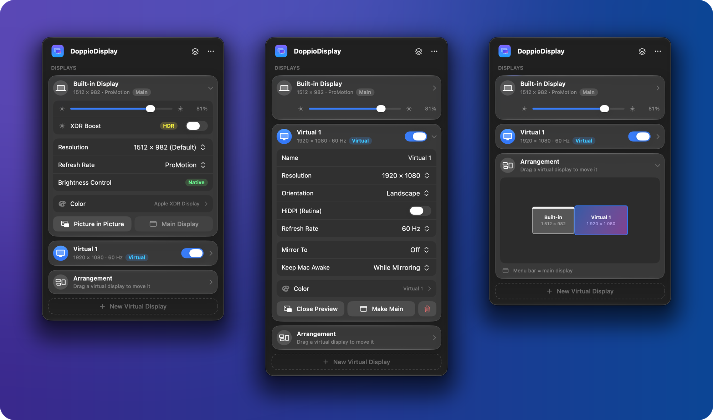
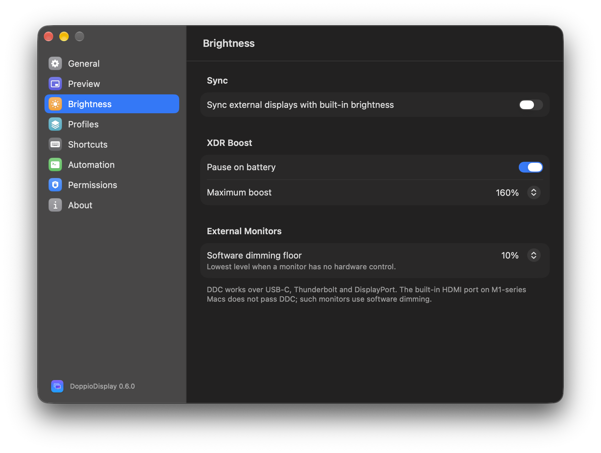

<p align="center">
  
</p>

<h1 align="center">DoppioDisplay</h1>

<p align="center">
  Virtual displays, mirroring, picture in picture, brightness and XDR boost for your Mac — from the menu bar.
</p>

<p align="center">
  
  
  
</p>

<p align="center">
  <a href="https://github.com/olinaive/DoppioDisplay/releases/latest"><b>⬇︎ Download for macOS</b></a>
  &nbsp;·&nbsp;
  <a href="README.ru.md">Русский</a>
</p>

<p align="center">
  
</p>

## What it does

DoppioDisplay creates **virtual displays** that macOS treats like real monitors. You can
mirror one onto an external monitor (for crisp HiDPI on any screen), watch and use it in a
**picture-in-picture** window on your MacBook, and control **brightness, color and XDR
extra brightness** of every display — all from a Liquid Glass panel in the menu bar.

## Features

**Virtual displays**
- Any number of virtual displays with presets or a custom resolution, HiDPI (Retina),
  30 / 60 / 120 Hz, landscape or portrait.
- Remembered across launches and restored after sleep, wake and WindowServer restarts.
- Drag-to-arrange map next to your real displays; make any display the main one
  (reverts after 15 s unless you keep it).
- *Keep Mac awake* while a virtual display is on or mirrored.

**Mirroring**
- Mirror a virtual display to an external monitor — e.g. a HiDPI 1920 × 1080 desktop on a
  4K screen. The mirror is re-applied when the monitor comes back after sleep or replugging.

**Picture in picture**
- Live preview of any virtual or physical display, or of a single window (system picker).
- Crop an area, rotate, flip, 15–120 fps, keep on top, minimize to the Dock (optionally
  with a live thumbnail).
- **Work inside the preview:** double-click or ⌘-click captures the cursor into the
  previewed display; ⌘⎋ releases it.

**Brightness and color**
- Built-in display: hardware brightness, resolution and refresh rate (ProMotion),
  presets such as *Apple XDR Display (P3-1600 nits)*, ICC profile, True Tone, Night Shift.
- External monitors: DDC/CI brightness, contrast, volume, mute and input source;
  software dimming when a monitor has no hardware control.
- **XDR Boost:** up to 1.3–2× the normal brightness on MacBook Pro XDR panels, paused on
  battery if you like.

**Profiles and automation**
- Save the whole setup (virtual displays, mirrors, positions, brightness, XDR) as a
  profile; apply it from the menu, with ⌃⌥⌘1…9, or automatically when a given monitor
  connects or disconnects.
- Global shortcuts, a `doppio://` URL scheme and a `doppio` command-line tool — works with
  Raycast, Alfred, Shortcuts and scripts.

<table>
  <tr>
    <td width="50%"></td>
    <td width="50%"></td>
  </tr>
  <tr>
    <td align="center">Settings · General</td>
    <td align="center">Settings · Brightness and XDR Boost</td>
  </tr>
</table>

## Requirements

- macOS 26 Tahoe or later (developed and tested on macOS 27.2).
- Apple Silicon (tested on an M1 Pro MacBook Pro). Intel Macs are untested.

## Install

1. Download **DoppioDisplay-x.y.z.zip** from the [latest release](https://github.com/olinaive/DoppioDisplay/releases/latest) and unzip it.
2. Move **DoppioDisplay.app** to **Applications**.
3. Open it. The app is not notarized by Apple (that needs a paid developer account), so the
   first launch is blocked: open **System Settings › Privacy & Security**, scroll down and
   click **Open Anyway** next to DoppioDisplay. You only do this once.

   Or in Terminal: `xattr -dr com.apple.quarantine /Applications/DoppioDisplay.app`

Updates are signed with the same certificate, so macOS keeps your permissions when you
replace the app with a newer version.

### Build from source

Requires Xcode 26 or later.

```sh
git clone https://github.com/olinaive/DoppioDisplay.git
cd DoppioDisplay

# Optional but recommended: a local signing certificate, so macOS keeps
# Screen Recording / Accessibility permissions across rebuilds.
./scripts/create-signing-identity.sh

./scripts/build-app.sh          # → build/DoppioDisplay.app
open build/DoppioDisplay.app
```

`create-signing-identity.sh` adds a self-signed certificate named *DoppioDisplay Local
Signing* to your login keychain. It only signs builds on your Mac; it contains no personal
information and can be removed in Keychain Access.

### Permissions

| Permission | Needed for |
|---|---|
| Screen & System Audio Recording | Previews and picture in picture |
| Accessibility | Working inside a preview (cursor capture) |
| Administrator password (once) | Installing the `doppio` command into `/usr/local/bin` |

Grant them in **System Settings › Privacy & Security**; the app links there from
**Settings › Permissions**.

## Usage


1. Click the menu bar icon, then **New Virtual Display**.
2. Expand the display card to change resolution, HiDPI, refresh rate, orientation, color,
   or **Mirror To** an external monitor.
3. **Preview** opens the picture-in-picture window. Double-click inside it to work on that
   display; press **⌘⎋** to get the cursor back.
4. Expand **Arrangement** and drag a virtual display to place it next to your screens.
5. Save the setup from the profiles menu (stack icon) and give it a rule in
   **Settings › Profiles** to apply it automatically.

### Keyboard shortcuts

| Shortcut | Action |
|---|---|
| ⌃⌥⌘V | First virtual display on/off |
| ⌃⌥⌘P | Show/hide preview |
| ⌃⌥⌘X | XDR Boost on/off |
| ⌃⌥⌘↑ / ↓ | Brightness of the display under the cursor |
| ⌃⌥⌘1…9 | Apply profile 1…9 |
| ⌘⎋ | Release a captured cursor |

### URL scheme and command line

```sh
open "doppio://create?width=2560&height=1440&hidpi=1"
open "doppio://preview?action=toggle"
open "doppio://xdr?on=toggle&level=0.8"
open "doppio://brightness?display=builtin&value=0.6"
open "doppio://profile?name=Desk"
open "doppio://panel?expand=builtin,arrangement"   # panel as a floating window

doppio create width=2560 height=1440               # after Settings › Automation › Install
```

Commands: `create`, `enable`, `disable`, `toggle`, `remove`, `resolution`, `preview`,
`mirror`, `xdr`, `brightness`, `profile`, `settings`, `panel`. Parameters are documented
in [`URLCommands.swift`](Sources/DoppioDisplay/URLCommands.swift).

## How it works

macOS has no public API for some of this, so DoppioDisplay uses private frameworks,
resolved at runtime. If a macOS update removes one, the matching controls hide
themselves instead of crashing (see **Settings › About**).

| Feature | API |
|---|---|
| Virtual displays | `CGVirtualDisplay` (CoreGraphics, private) |
| Mirroring, arrangement, resolutions | Quartz Display Services (public) |
| Preview / PiP | ScreenCaptureKit (public) |
| Built-in brightness | DisplayServices (private) |
| DDC/CI | `IOAVService` (IOKit, private) |
| Presets | MonitorPanel (private) |
| Night Shift, True Tone | CoreBrightness (private) |
| ICC profiles | ColorSync (public) |
| XDR Boost | EDR (Metal `preferredDynamicRange`) + gamma tables (public) |

Because of the private APIs the app cannot be distributed through the Mac App Store and
runs without the App Sandbox.

**Privacy:** DoppioDisplay makes no network connections and collects nothing. Screen
capture stays on your Mac.

## Troubleshooting

- **Permissions reset after every build** — run `./scripts/create-signing-identity.sh`
  once and rebuild; ad-hoc signatures change on every build.
- **No DDC on an external monitor** — the built-in HDMI port of M1-series Macs does not
  pass DDC; use USB-C, Thunderbolt or DisplayPort. Without DDC the app falls back to
  software dimming.
- **Diagnostics** (read-only):
  `build/DoppioDisplay.app/Contents/MacOS/DoppioDisplay --selftest`,
  `--brightness-probe`, `--xdr-probe`, `--color-probe`, `--config-probe`.
- **Start from scratch** — quit the app and run `defaults delete app.doppiodisplay`.

## Project layout

```
Sources/DoppioDisplay/   app (SwiftUI + AppKit)
  Brightness/            brightness, DDC, XDR Boost, color
  Views/                 menu bar panel, settings, controls
Sources/CPrivateAPI/     private API declarations and Objective-C shims
Resources/Doppio.icon    app icon (Icon Composer package)
scripts/                 build, signing, CLI
design/tools/            icon generators
```

## License

DoppioDisplay is **free for personal and other noncommercial use** under the
[PolyForm Noncommercial License 1.0.0](LICENSE.md). Using it for commercial purposes —
including at work for a company — needs a separate commercial license; open an issue or
contact [@olinaive](https://github.com/olinaive).

It builds on open-source work credited in [THIRD_PARTY_NOTICES.md](THIRD_PARTY_NOTICES.md):
MonitorControl, DeskPad, vdscreen, force-hidpi and KhaosT/CGVirtualDisplay.

DoppioDisplay is not affiliated with Apple Inc. or with BetterDisplay. macOS, MacBook Pro,
ProMotion, True Tone and Night Shift are trademarks of Apple Inc.
