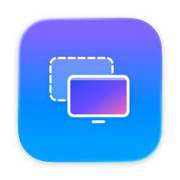
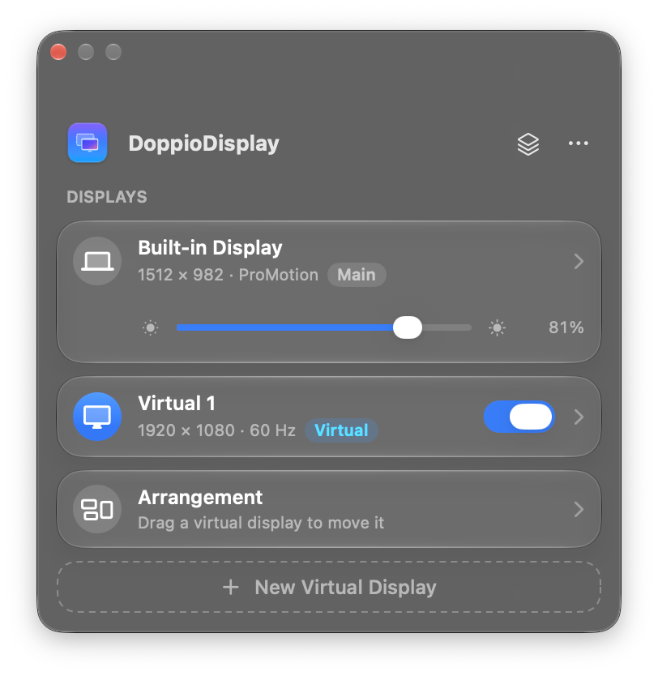
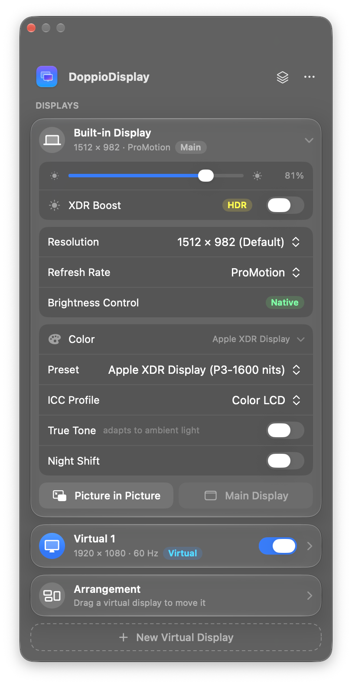
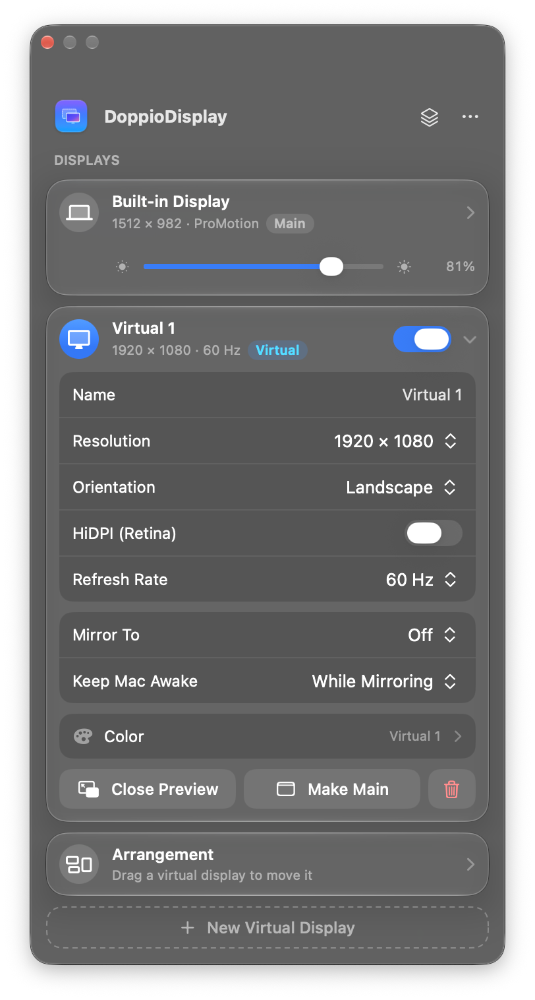
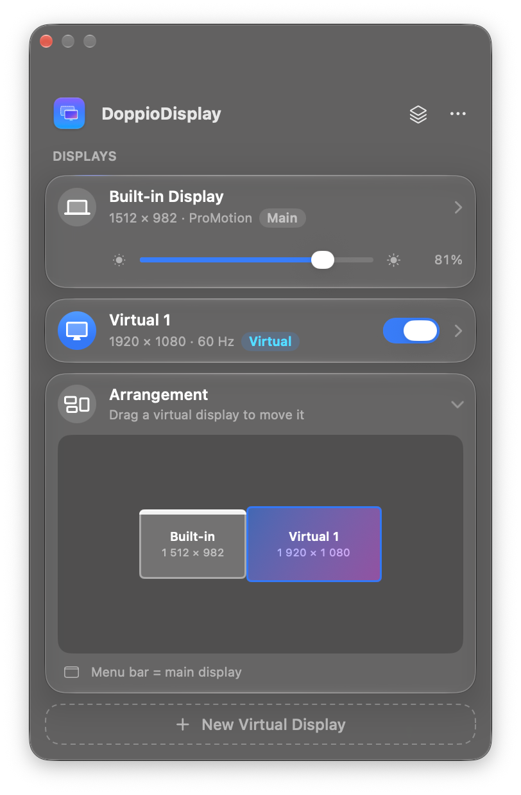
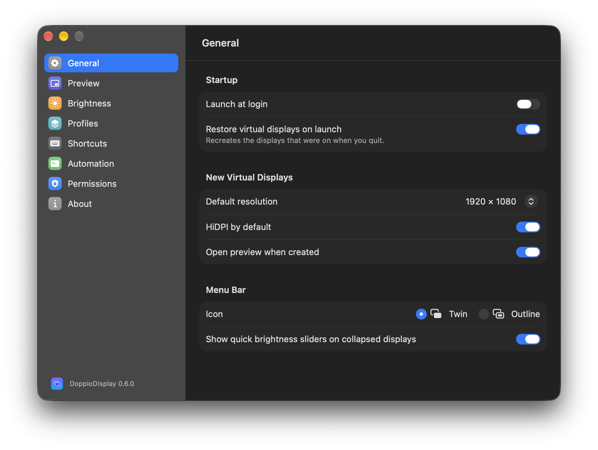

<p align="center">
  
</p>

<h1 align="center">DoppioDisplay</h1>

<p align="center">
  Виртуальные дисплеи, зеркалирование, «картинка в картинке», яркость и XDR-буст для Mac — прямо из menu bar.
</p>

<p align="center">
  <a href="README.md">English</a> ·
  
  
  
</p>

<p align="center">
  
  
  
</p>

## Что это

DoppioDisplay создаёт **виртуальные дисплеи**, которые macOS считает настоящими мониторами.
Виртуальный экран можно зеркалить на внешний монитор (чёткий HiDPI на любом экране),
смотреть и работать с ним в окне **«картинка в картинке»** на MacBook, а ещё управлять
**яркостью, цветом и XDR-бустом** всех экранов — из стеклянной панели в menu bar.

## Возможности

**Виртуальные дисплеи**
- Сколько угодно виртуальных экранов: пресеты или своё разрешение, HiDPI (Retina),
  30 / 60 / 120 Гц, альбомная или портретная ориентация.
- Запоминаются между запусками и восстанавливаются после сна и перезапуска WindowServer.
- Карта раскладки с перетаскиванием рядом с настоящими экранами; любой экран можно сделать
  главным (через 15 с всё вернётся, если не подтвердить).
- *Не давать Mac уснуть*, пока виртуальный экран включён или зеркалится.

**Зеркалирование**
- Зеркалирование виртуального экрана на внешний монитор — например, HiDPI 1920 × 1080 на 4K.
  Зеркало восстанавливается, когда монитор возвращается после сна или переподключения.

**Картинка в картинке**
- Живое превью любого виртуального или физического экрана или отдельного окна (системный выбор).
- Кадрирование, поворот, отражение, 15–120 кадров/с, поверх окон, сворачивание в Dock
  (по желанию — с живой миниатюрой).
- **Работа внутри превью:** двойной клик или ⌘-клик «захватывает» курсор на этот экран,
  ⌘⎋ отпускает.

**Яркость и цвет**
- Встроенный экран: аппаратная яркость, разрешение и частота (ProMotion), пресеты вроде
  *Apple XDR Display (P3-1600 nits)*, ICC-профиль, True Tone, Night Shift.
- Внешние мониторы: яркость, контраст, громкость, mute и выбор входа по DDC/CI;
  программное затемнение, если у монитора нет аппаратного управления.
- **XDR Boost:** до 1,3–2× обычной яркости на XDR-экранах MacBook Pro, с паузой на батарее.

**Профили и автоматизация**
- Вся конфигурация (виртуальные экраны, зеркала, позиции, яркость, XDR) сохраняется
  в профиль; применить — из меню, по ⌃⌥⌘1…9 или автоматически при подключении
  или отключении нужного монитора.
- Глобальные хоткеи, URL-схема `doppio://` и команда `doppio` в терминале — работает
  с Raycast, Alfred, «Быстрыми командами» и скриптами.

<p align="center">
  
  
</p>

## Требования

- macOS 26 Tahoe или новее (разработано и проверено на macOS 27.2).
- Apple Silicon (проверено на MacBook Pro M1 Pro). На Intel не проверялось.
- Для сборки: Xcode 26 или новее.

## Установка

Готовых сборок пока нет, собирается из исходников:

```sh
git clone https://github.com/olinaive/DoppioDisplay.git
cd DoppioDisplay

# Необязательно, но рекомендуется: локальный сертификат подписи, чтобы macOS
# не сбрасывала разрешения Screen Recording / Accessibility при каждой пересборке.
./scripts/create-signing-identity.sh

./scripts/build-app.sh          # → build/DoppioDisplay.app
open build/DoppioDisplay.app    # или сначала перенеси в /Applications
```

`create-signing-identity.sh` добавляет в связку ключей login самоподписанный сертификат
*DoppioDisplay Local Signing*. Он подписывает сборки только на твоём Mac, личных данных
не содержит и удаляется в «Связке ключей».

### Разрешения

| Разрешение | Для чего |
|---|---|
| Запись экрана и системного звука | Превью и «картинка в картинке» |
| Универсальный доступ (Accessibility) | Работа внутри превью (захват курсора) |
| Пароль администратора (один раз) | Установка команды `doppio` в `/usr/local/bin` |

Выдаются в **Системные настройки › Конфиденциальность и безопасность**; из приложения туда
ведёт **Settings › Permissions**.

## Как пользоваться

1. Нажми значок в menu bar → **New Virtual Display**.
2. Раскрой карточку экрана: разрешение, HiDPI, частота, ориентация, цвет или
   **Mirror To** — зеркало на внешний монитор.
3. **Preview** открывает окно «картинка в картинке». Двойной клик внутри — работа на этом
   экране; **⌘⎋** возвращает курсор.
4. Раскрой **Arrangement** и перетащи виртуальный экран к нужной стороне.
5. Сохрани конфигурацию в меню профилей (значок стопки) и задай ей правило в
   **Settings › Profiles**, чтобы она включалась сама.

### Горячие клавиши

| Сочетание | Действие |
|---|---|
| ⌃⌥⌘V | Включить/выключить первый виртуальный экран |
| ⌃⌥⌘P | Показать/скрыть превью |
| ⌃⌥⌘X | XDR Boost вкл/выкл |
| ⌃⌥⌘↑ / ↓ | Яркость экрана под курсором |
| ⌃⌥⌘1…9 | Применить профиль 1…9 |
| ⌘⎋ | Отпустить захваченный курсор |

### URL-схема и командная строка

```sh
open "doppio://create?width=2560&height=1440&hidpi=1"
open "doppio://preview?action=toggle"
open "doppio://xdr?on=toggle&level=0.8"
open "doppio://brightness?display=builtin&value=0.6"
open "doppio://profile?name=Desk"
open "doppio://panel?expand=builtin,arrangement"   # панель отдельным окном

doppio create width=2560 height=1440               # после Settings › Automation › Install
```

Команды: `create`, `enable`, `disable`, `toggle`, `remove`, `resolution`, `preview`,
`mirror`, `xdr`, `brightness`, `profile`, `settings`, `panel`. Параметры описаны
в [`URLCommands.swift`](Sources/DoppioDisplay/URLCommands.swift).

## Как это устроено

Для части функций у macOS нет публичного API, поэтому DoppioDisplay использует приватные
фреймворки и подключает их во время работы. Если обновление macOS что-то уберёт,
соответствующие настройки просто скроются, а приложение не упадёт (см. **Settings › About**).

| Функция | API |
|---|---|
| Виртуальные дисплеи | `CGVirtualDisplay` (CoreGraphics, приватный) |
| Зеркалирование, раскладка, разрешения | Quartz Display Services (публичный) |
| Превью / PiP | ScreenCaptureKit (публичный) |
| Яркость встроенного экрана | DisplayServices (приватный) |
| DDC/CI | `IOAVService` (IOKit, приватный) |
| Пресеты | MonitorPanel (приватный) |
| Night Shift, True Tone | CoreBrightness (приватный) |
| ICC-профили | ColorSync (публичный) |
| XDR Boost | EDR (Metal `preferredDynamicRange`) + таблицы гаммы (публичные) |

Из-за приватных API приложение нельзя выложить в Mac App Store, и оно работает без песочницы.

**Конфиденциальность:** DoppioDisplay не выходит в сеть и ничего не собирает. Захват экрана
остаётся на твоём Mac.

## Если что-то не так

- **Разрешения сбрасываются после каждой сборки** — один раз запусти
  `./scripts/create-signing-identity.sh` и пересобери: ad-hoc-подпись меняется с каждой сборкой.
- **Внешний монитор без DDC** — встроенный HDMI на Mac с M1 не передаёт DDC; подключай
  по USB-C, Thunderbolt или DisplayPort. Без DDC работает программное затемнение.
- **Диагностика** (только чтение):
  `build/DoppioDisplay.app/Contents/MacOS/DoppioDisplay --selftest`,
  `--brightness-probe`, `--xdr-probe`, `--color-probe`, `--config-probe`.
- **Начать с нуля** — закрой приложение и выполни `defaults delete app.doppiodisplay`.

## Структура проекта

```
Sources/DoppioDisplay/   приложение (SwiftUI + AppKit)
  Brightness/            яркость, DDC, XDR Boost, цвет
  Views/                 панель menu bar, настройки, контролы
Sources/CPrivateAPI/     объявления приватных API и Objective-C-прослойки
Resources/Doppio.icon    иконка приложения (пакет Icon Composer)
scripts/                 сборка, подпись, CLI
design/tools/            генераторы иконки
```

## Лицензия

DoppioDisplay **бесплатен для личного и любого некоммерческого использования** по
[PolyForm Noncommercial License 1.0.0](LICENSE.md). Для коммерческого использования —
в том числе на работе в компании — нужна отдельная коммерческая лицензия: создай issue
или напиши [@olinaive](https://github.com/olinaive).

Проект опирается на открытый код, перечисленный в
[THIRD_PARTY_NOTICES.md](THIRD_PARTY_NOTICES.md): MonitorControl, DeskPad, vdscreen,
force-hidpi и KhaosT/CGVirtualDisplay.

DoppioDisplay не связан с Apple Inc. и с BetterDisplay. macOS, MacBook Pro, ProMotion,
True Tone и Night Shift — товарные знаки Apple Inc.
